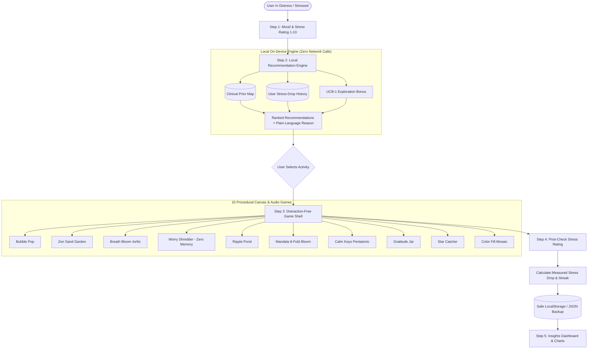

# 🌿 CalmPop — Adaptive, Single-Player Stress Relief

> **Hackathon Problem Statement:** *"Create a technology solution that makes an everyday activity more convenient, efficient or accessible."*  
> **Everyday Activity:** Managing daily stress.  
> **One-Line Pitch:** *"A private, single-player stress relief app that learns which calming activity actually works for YOU, and recommends it based on your mood."*

---

## 🌟 Why CalmPop?

Most mindfulness and meditation apps treat every user the same, force accounts and cloud tracking, and charge monthly subscriptions. 

**CalmPop takes the opposite approach:**
1. **100% Private & On-Device:** Zero accounts, zero login, zero cloud servers, zero analytics, zero external network requests.
2. **Journey Mode (Guided Sequences):** Automatically builds a 3, 4, or 5 level journey tailored to your mood—starting with a gentle tactile starter, progressing through core regulators, and finishing with a grounding somatic wind-down.
3. **Truly Personalized:** Powered by a local multi-armed bandit algorithm that measures your real stress drop before and after each level.
4. **10 Calming Sensory & Somatic Micro-Games:** 60fps canvas animations, tactile ripples, and procedural Web Audio synthesized sounds (0 audio files)—including our redone large-target Bubble Pop with rising combo drags.
5. **Offline PWA:** Installable directly on mobile or desktop, working completely offline in airplane mode.

---

## 🏗️ Architecture Diagram



---

## 🧠 How the Recommendation Engine Works

CalmPop does not use external AI APIs or cloud models. Instead, it utilizes an on-device **Multi-Armed Bandit with Upper Confidence Bound (UCB-1)**:

$$\text{Score}(g, m) = \left( 1.5 \times \bar{\Delta}_{\text{stress}}(g, m) \right) + \text{PriorBonus}(g, m) + c \cdot \sqrt{\frac{\ln(N_m + 2)}{n_{g,m} + 1}}$$

### 1. Clinical Prior Map (Cold Start)
When a user begins, CalmPop starts with evidence-based pairings:
- **Anxious:** Breath Bloom, Calm Keys, Ripple Pond
- **Angry:** Worry Shredder, Bubble Pop, Color Fill
- **Sad:** Gratitude Jar, Star Catcher, Calm Keys
- **Tired:** Zen Sand, Breath Bloom, Ripple Pond
- **Overwhelmed:** Breath Bloom, Worry Shredder, Zen Sand
- **Restless:** Mandala Bloom, Bubble Pop, Star Catcher
- **Okay:** Color Fill, Gratitude Jar, Mandala Bloom

### 2. Measured Stress Drop $\bar{\Delta}_{\text{stress}}(g, m)$
After every session, the app records:
$$\text{Stress Drop} = \text{Stress}_{\text{Before}} - \text{Stress}_{\text{After}}$$
If a non-prior activity (e.g. *Mandala Bloom*) consistently drops your anxiety from an 8 to a 2, the algorithm promotes Mandala to your #1 recommendation.

### 3. Exploration Bonus (UCB-1)
To prevent the app from getting stuck in local optima, the exploration term gives a boost to untried activities for that mood, ensuring continuous discovery.

### 4. Plain-Language Transparency
Every recommendation comes with a human-readable explanation:
- *"Proven match: lowered your stress by 3.2 on average when anxious."*
- *"Curated activity designed specifically for easing overwhelmed states."*
- *"Discovery pick: explore an untried calming ritual to reset your mindset."*

The built-in **"Explain My Recommendation"** sheet displays the exact mathematical scoring breakdown for complete transparency.

---

## 🎮 The 10 Calming Micro-Games

| Game | Category | Calming Mechanism | Sound Synthesis |
| :--- | :--- | :--- | :--- |
| **Bubble Pop** | Tactile | 12 large 72px+ bubbles with squash-burst animation, rising combo drags, and auto-refill | Pitch-varied rising combo pop sweeps |
| **Zen Sand** | Focus | 3-tine rake interactive sand garden with wave smoothing | Filtered whispering sand friction |
| **Breath Bloom** | Somatic | 4s inhale / 6s exhale vagus nerve stimulation | Resonant Tibetan singing bowl harmonics |
| **Worry Shredder** | Reflective | Type your worry, shred it into confetti (100% zero retention) | Procedural tearing paper bursts |
| **Ripple Pond** | Focus | Concentric water ripples across a twilight pond | Resonant water droplets & soft rain |
| **Mandala Bloom** | Creative | 8-fold radial kaleidoscopic drawing in shifting pastels | Harmonic pentatonic bell tones |
| **Calm Keys** | Auditory | Pentatonic chime instrument where every melody harmonizes | Pure bell overtones (C Major Pentatonic) |
| **Gratitude Jar** | Reflective | Capture 1 daily blessing in glowing starlight; shake to inspect | Shimmering celesta star chimes |
| **Star Catcher** | Focus | Soft drifting stars with stardust bursts | Celestial chime sparkle bursts |
| **Color Fill** | Tactile | Mosaic tile cycling with harmonizing pastel palettes | Tactile wooden/marimba clicks |

---

## 🛡️ Privacy & Offline Architecture

- **Default Build (Zero Network Requests):** In the default release build, CalmPop operates 100% locally on-device. No telemetry, no third-party CDNs, and zero external network requests are made.
- **Strict In-Memory Worry Shredder:** The Worry Shredder tears text in volatile JavaScript memory and wipes state immediately upon shredding. It is never written to storage, IndexedDB, or server logs.
- **Data Portability:** Complete export and import of backup files as `.json`.
- **Nuclear Delete Option:** Visible *"Delete All My Data"* button with two-step confirmation in Settings.
- **Wellbeing Support:** Prominent *"Not Medical Advice"* guidance with immediate links to 24/7 free crisis helplines (988, findahelpline.com).

---

## 💰 Monetization (Optional)

CalmPop includes an optional, flag-controlled monetization integration for Google AdSense (`VITE_ADS_ENABLED=true` and `VITE_ADSENSE_CLIENT_ID`).

- **Disabled by default:** When the flag is false (the default shipped state), the ad code is completely inactive or tree-shaken, making zero network calls.
- **Consent-Gated (Consent Mode v2):** When enabled, an interactive CMP consent banner loads before any ad scripts. Users can choose "Accept All", "Non-Personalized Only", or "Reject All", and adjust this at any time in Settings.
- **Calm-First Placement Rules:**
  - Ads are **NEVER** displayed during game sessions, Breath Bloom exercises, tension check-ins, the Worry Shredder, or crisis helpline views.
  - Allowed only on the Insights dashboard and Landing page, strictly limited to 1 responsive banner per screen with fixed min-height to prevent layout shifts (CLS).
  - Mood scores and mental wellness data are strictly partitioned on-device and never shared with advertising partners.
- **Offline & Graceful Collapse:** If offline, blocked by ad blockers, or if the request fails, ad slots collapse seamlessly without layout shifts or console errors.

---

## 🚀 Getting Started

### Prerequisites
- Node.js (v18+)
- npm

### Installation & Running Locally
```bash
# Clone the repository and enter directory
cd CalmPop

# Install dependencies
npm install

# Run the local development server
npm run dev

# Run unit tests
npm test
# or: npx vitest run

# Build for production
npm run build
```

Open `http://localhost:5173/` in any modern web browser.

---

## ♿ Accessibility Features
- **Keyboard Navigation:** Full support for Tab, Enter, Space, and Arrow keys across sliders and keys.
- **Prefers Reduced Motion:** Smooth fallback to minimal transitions when OS reduced motion is active.
- **Larger Text Mode:** Dedicated toggle in Settings for increased typography hierarchy.
- **Audio Control:** Global mute toggle and volume sliders.
- **High Contrast:** Handcrafted light and dark palettes passing WCAG AA contrast standards.
